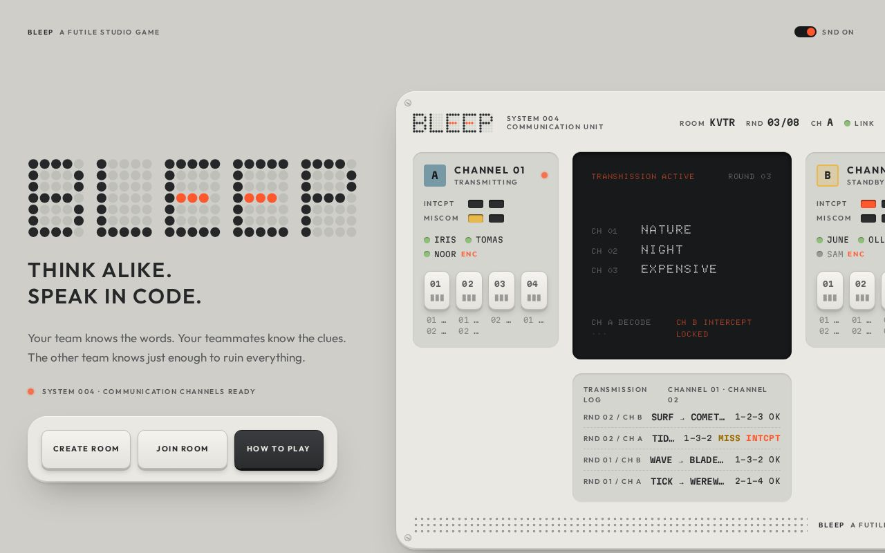

<div align="center">



# BLEEP

**Think alike. Speak in code. A word game for your phones and the big screen.**

[Play it](https://bleep.futile.studio) · [Futile Studio](https://futile.studio)

[](https://bleep.futile.studio)


</div>

> **Futile Studio** · Games, word game · Live since Nov 2026

## Overview

BLEEP is a multiplayer web adaptation of the mechanics of Decrypto (Le Scorpion Masqué). Two channels, four secret keywords each, three clues per transmission, and an opposing channel trying to intercept. Your team knows the words. The other team knows just enough to ruin everything.

Fan adaptation, not affiliated with Le Scorpion Masqué.

## How to play

- Open `/` on any device and create or join a room.
- Each player opens `/ROOM` on their phone. That's their private controller.
- Put `/ROOM/console` on a TV or laptop. It's the shared screen and never receives private data.
- 4 to 12 players, at least 2 per channel.
- Each round, one player per channel is the encryptor. They get a three-digit code and give one clue per digit. Their teammates decode it, and from round 2 the other channel tries to intercept.

There's also a how to play screen inside the room.

## Rules implemented

- Round 1: no interceptions. From round 2, the opposing channel locks an interception at the same time as the decode.
- Channel A transmits and reveals first, then channel B.
- 30-second sand timer once the first encryptor seals; the late encryptor's draft is sent as is.
- Encryptor rotates through each channel every round. If the encryptor disconnects, a teammate can take over.
- Wrong decode: miscommunication token. Correct interception: interception token.
- Checked at round end: 2 interceptions win, 2 miscommunications lose. Both, or round 8: score (interceptions minus miscommunications), then a keyword-guessing tiebreak.

## Privacy

The server is authoritative. `shared/engine.ts` `view()` builds each device's payload: the code goes only to the encryptor, keywords only to their own channel, and the console gets the public state only. Tests in `shared/engine.test.ts` and `server/server.test.ts` check this.

## Stack

- React 19, Vite, Tailwind CSS 4, Motion
- Node 20+ with Express 5 and Socket.IO 4, run through `tsx`
- Vitest for the rules engine and server, `playwright-core` for the browser run

## Running it locally

```sh
npm install --include=dev
npm run dev        # server :4410 + vite :5180
npm run build && npm start   # production on :4410 (PORT to change)
```

State persists to `data/rooms.json` (`BLEEP_DATA` to move it). Rooms expire after 12 hours idle.

## Tests

```sh
npm test           # rules engine + real Socket.IO clients
npm run typecheck
npm run e2e        # full game in 5 headless Chromium contexts, screenshots in e2e/shots
```

`npm run e2e` needs a Playwright Chromium (`npx playwright-core install chromium-headless-shell`).

## Configuration

| Variable | Purpose |
| --- | --- |
| `PORT` | Server port, default `4410` |
| `BLEEP_DATA` | Folder for `rooms.json`, default `data/` |
| `LOBBY_GRACE_MS` | How long a disconnected player stays in the lobby before being dropped, default 20000 |
| `NODE_ENV` | `production` turns off the dev CORS setting. The server serves `dist/` whenever it exists |

## Deployment

The `Dockerfile` builds one container: the server serves the built site and the Socket.IO channel on port 4410. On every push to `main`, the `image` workflow typechecks, runs the tests and pushes the image to GHCR. `deploy/` holds the compose file and Caddy block I use to run it.

## Project structure

```
shared/   rules engine, per-device views, word list
server/   Express + Socket.IO server, room storage
src/      landing, phone controller, console
e2e/      headless full-game run
deploy/   compose, Caddy and deploy script
```

## Licence

No licence file yet, all rights reserved.

---

<p align="center">
  <a href="https://futile.studio"></a>
  <br>
  <sub>Built by <a href="https://github.com/MayurJivani">Mayur Jivani</a>. Everything is futile. Do it anyway.</sub>
</p>
